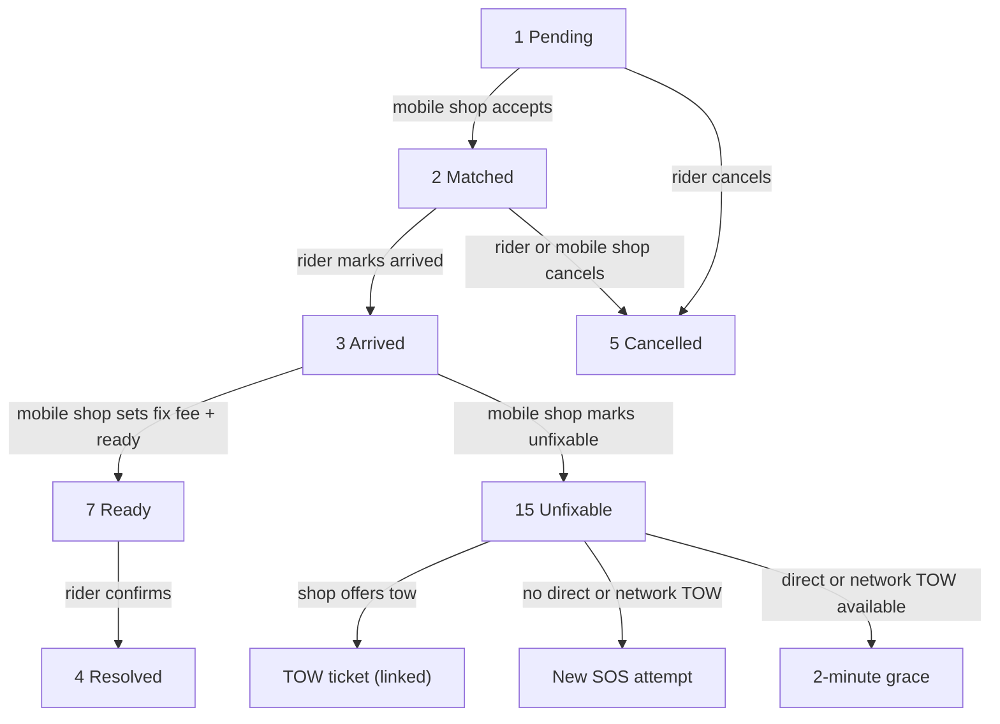
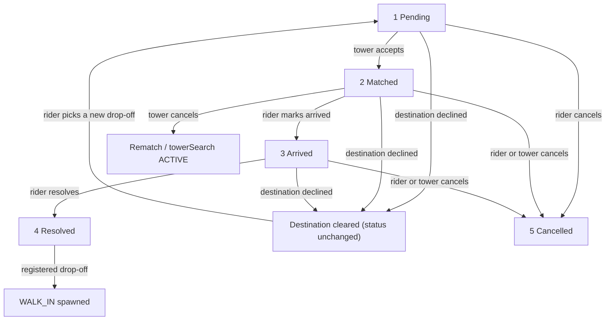
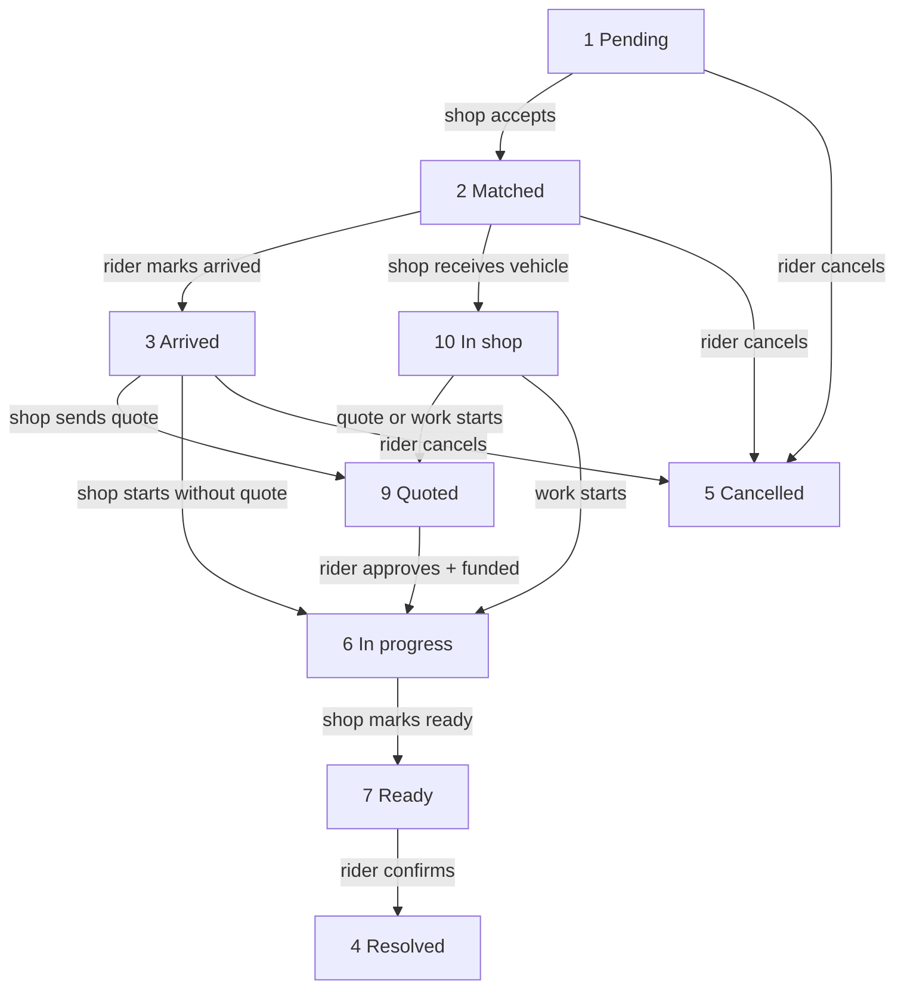
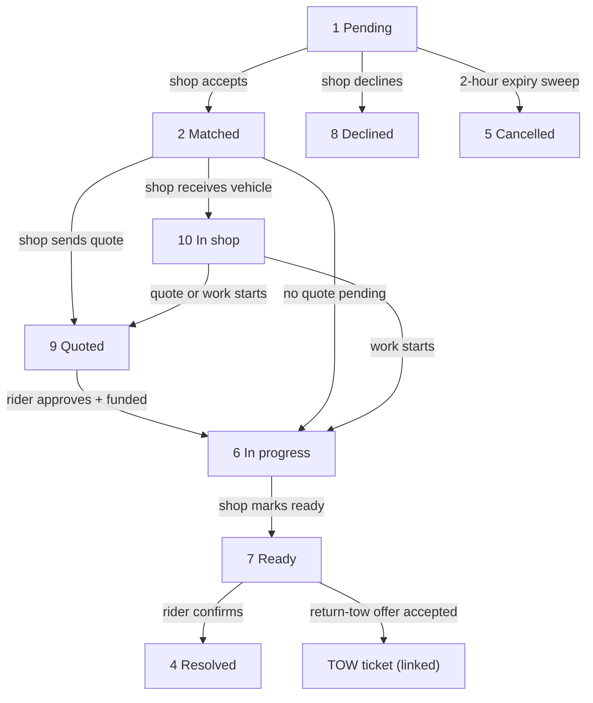

# Status Codes

All entity statuses in the backend are **short numeric codes stored as strings** (`"1"`, `"2"`, …), in the same style as [role codes](./ARCHITECTURE.md). API responses and request bodies carry codes only; clients resolve human-readable names at runtime via `POST /statuses`.

## Single source of truth

`functions/constants/status.ts` defines `STATUS_USER`, `STATUS_FLAGS`, and `STATUS_DISPATCH` plus the `*_STATUSES` definition records (`domain`, `code`, `name`, `description`, `order`). Everything else derives from it, so stored and accepted codes cannot drift:

- `functions/validation/schemas.ts` builds the Joi status enums from `Object.values(...)` of these constants.
- `functions/scripts/db.init.ts` seeds the `statuses` collection from `STATUS_GROUPS` (merge writes, so re-running is safe).
- `POST /statuses` serves whatever is in the collection, grouped by domain and sorted by `order`.

## Domains

### users

| Code | Name | Meaning |
|------|------|---------|
| `"1"` | Active | User can authenticate and use protected endpoints |
| `"0"` | Inactive | User is blocked from authenticating |

Stored in the `status` field of `users` docs (replaces the old boolean). `requireAuth` rejects inactive users with `403`; the Auth `disabled` flag is synced from this field.

### flags

| Code | Name | Meaning |
|------|------|---------|
| `"1"` | Suggested | Submitted by a rider, awaiting consensus votes |
| `"2"` | Confirmed | Reached the consensus vote threshold |
| `"3"` | Locked | Pinned by an admin, unaffected by voting |
| `"4"` | Expired | TTL lapsed, swept by the expire job |
| `"5"` | Rejected | Dismissed by an admin |

Stored in the `status` field of `flags` docs. New flags are created as `"1"`; the expire sweep targets the active set.

### dispatch

| Code | Name | Meaning |
|------|------|---------|
| `"1"` | Pending | Ticket opened, awaiting a match |
| `"2"` | Matched | Helper assigned and en route |
| `"3"` | Arrived | Helper on scene |
| `"4"` | Resolved | Ticket completed |
| `"5"` | Cancelled | Ticket withdrawn |
| `"6"` | In progress | Repair work underway |
| `"7"` | Ready | Work done, awaiting rider confirmation |
| `"8"` | Declined | Provider cannot take the job |
| `"9"` | Quoted | Shop quote sent, awaiting rider approval |
| `"10"` | In shop | Vehicle received at the shop, work pending (operator sets via status endpoint from `2`/`3`/`9`/`14`) |
| `"11"` | Final quoted | Reserved legacy final-quote code. Current `sendQuote` rejects `finalAmount` and writes only `"9"`; `approveQuote` still accepts `"11"` for old tickets. |
| `"12"` | Resolved unfixable | Reserved close-out code — defined and treated as terminal, no writer (`markUnfixable` closes at `15`) |
| `"13"` | Estimated | Reserved legacy estimate code. Tow estimates are advisory fields and do not move status; no current writer. |
| `"14"` | Estimate approved | Reserved legacy estimate-approved code. `approveEstimate` still accepts `"13"` for old tickets; no current writer. |
| `"15"` | Unfixable | Closed as unfixable with evidence on file (via `POST /dispatch/unfixable`; SOS is call-out-only, shop tickets refund in full, no `final`) |

Stored in the `status` field of `dispatch_tickets` docs. New tickets are created as `"1"`. The table above is helper-neutral on purpose — who can hold a ticket differs per kind (see below); the served `description` strings mirror this table verbatim.

Terminal codes (`4`/`5`/`8`/`12`/`15`) accept no further moves. `2` is set only by `POST /dispatch/accept` (claiming stays atomic); `9`/`11`/`13`/`14`/`15` come only from the quote/estimate/unfixable endpoints — `PUT /dispatch/status` refuses them. Arrival and resolution belong to the rider (`2→3`, `3→4`, `7→4`); work states belong to the shop operator (`3→6→7`, plus walk-in `2→6` only with no quote pending — quoted/final-quoted tickets start via `POST /dispatch/quote/approve`, which moves `9→6` or `11→6` with the rider as actor and requires a funded payment); SOS fix completion belongs to the assigned mobile shop (`3→7`, fix fee required) and the rider then confirms (`7→4`). Cancel belongs to the rider from any non-terminal status except `6` (committed — stalled jobs go through admin support) and SOS `7` (fix complete — the fix fee stands); decline (`8`) belongs to the named shop on a pending walk-in. Admins bypass the matrix. See `API.md` → Dispatch for the full matrix and `PIPELINE.md` for the push fired per move.

Shop tickets use a single binding quote: the shop sends `POST /dispatch/quote`
(`"9"` Quoted, amount immutable), the rider approves with a funded charge, and
the ticket moves to `"6"` In progress. Codes `"11"` Final quoted, `"13"`
Estimated, and `"14"` Estimate approved are reserved for legacy records and
have no current writer. `approveQuote` still accepts old `"11"` tickets and
`approveEstimate` still accepts old `"13"` tickets.

Tow estimates: the drop-off shop can pre-quote a repair while the tow is
inbound — allowed on `"1"`/`"2"`/`"3"`, one live-or-approved estimate at a
time, 24-hour TTL, and the ticket status does not move (the tow row keeps its
own `1`→`2`→`3`→`4` lifecycle). The rider's approval is advisory: it only
stamps `estimateApprovedAt`. A decline clears the estimate block, reopens
drop-off picking when the declining shop held the destination
(`needsNewDestination: true`, shop appended to `declinedShopIds`), and still
leaves status untouched. Destination edits and destination declines clear any
estimate on file.

Reachability per ticket kind (all else is rejected by the transition matrix):

| Kind | Reachable codes |
|------|-----------------|
| SOS | `1` → `2` (mobile shop claim) → `3` → `7` (mobile shop fix complete, fix fee required) → `4` (rider confirms); `15` from `3` when the shop cannot fix, call-out-only (or waived within 1 km), then an automatic continuation SOS when neither a same-vehicle TOW nor a network TOW is available, otherwise a 2-minute grace for the shop to offer/release; `5` by rider cancel except at `7`. No work or quotes. |
| TOW | `1` (pickup + destination mandatory) → `2` (tower claim, ETA on fresh fix) → `3` (at pickup) → `4`, which auto-spawns a linked `WALK_IN` at a registered destination. `5` by rider cancel pre-work. No `6`/`7`/`9` on this row — that lifecycle runs on the linked walk-in. Destination decline freezes the leg without touching status. The drop-off shop can pre-quote the repair while inbound (`POST /dispatch/estimate`; rider approve/decline, status untouched). |
| TOW destination accept | A tow naming a registered shop drop-off tells that shop (`"Incoming tow"`); the shop can accept implicitly or bow out (`POST /dispatch/destination/decline`), which needs a reason code and auto-files a `SHOP_DECLINE_DROPOFF` dispute. A decline clears the destination (+ any estimate on file), sets `needsNewDestination: true`, and keeps the engaged tower on the job — the rider picks a new drop-off (`POST /dispatch/destination`, which also clears any estimate on file), clearing `needsNewDestination` and restamping ETAs. Re-picking a declined shop is refused for the life of the ticket. |
| MECHANIC | `1` → `2` (shop accept) → `3` → `4`, with the full `9`/`6`/`7` workbench on shop-held tickets. `5` by rider cancel (not from `6`). No `8` (decline is walk-in-only). |
| WALK_IN | `1` → `2` (shop accept) → `9` (binding quote) → `6` (funded approval) → `7` → `4`, plus `2` → `6` when no quote is pending, `10` In shop, `8` (pending + operator only), and sweep expiry → `5`. Linked-spawn target on tow resolve. |
| `10` In shop | Marks vehicle receipt at the shop before work starts (operator, from `2`/`3`/`9`/`14`). |
| `12` Resolved unfixable | Reserved terminal close-out code — no writer; on-site unfixable verdicts close at `15` instead (SOS call-out-only, shop tickets refund in full, no `final`, no `completedJobs` increment). |

## Dispatch lifecycles

The diagrams below show the reachable transitions in the current code. Dashed/legacy codes (`11`, `12`, `13`, `14`) are kept for old records but have no current writer.

### SOS



ASCII fallback: `1 -> 2 -> 3 -> 7 -> 4`; `3 -> 15 -> (TOW | new SOS | 2-min grace)`; `1/2 -> 5`.

- A call-out is charged when the mobile shop accepts; an unfixable close keeps call-out only, waived when the shop was within 1 km at accept on a fresh fix. Each continuation attempt has its own call-out; prior call-outs remain payable.
- After `15`, a direct same-vehicle TOW or a network TOW may be offered. If neither is available, the continuation is created automatically. If either is available, the shop has a 2-minute grace to offer or release it. A network offer creates a pending broadcast TOW only after the rider confirms a drop-off; no tower is auto-assigned.
- The previous SOS attempt is shown on the linked TOW/continuation as `linkedSummary` (unfixable reason + shop evidence).

### TOW



ASCII fallback: `1 -> 2 -> 3 -> 4 -> WALK_IN`; destination decline keeps the status and sets `needsNewDestination`; cancel -> `5`; tower cancel -> rematch.

- Pickup + destination are mandatory at creation.
- `2` stamps pickup/drop-off ETA from a fresh tower fix.
- `3` starts the waiting clock; `4` closes it and spawns the drop-off `WALK_IN` for a registered shop destination. System-spawned car walk-ins are allowed.
- Tow repair estimates are advisory fields (`estimateAmount`, `estimateExpiresAt`, `estimateApprovedAt`) with a 24-hour TTL; they do not move status. Approval is advisory.
- A destination decline files a `SHOP_DECLINE_DROPOFF` dispute, clears the destination and any estimate, sets `needsNewDestination: true`, and keeps the engaged tower.
- `4` also auto-resolves a linked `WALK_IN` that is already `7 Ready`.

### MECHANIC



ASCII fallback: `1 -> 2 -> 3 -> (9 -> 6 | 6 | 10 -> 9/6) -> 7 -> 4`; cancel -> `5` (not from `6`).

### WALK_IN



ASCII fallback: `1 -> 2 -> (9 -> 6 | 6 | 10 -> 9/6) -> 7 -> 4`; `1 -> 8`; `1 -> 5` on expiry; `7 -> TOW` via return-tow.

- `7` creates a pending return-tow offer; accepting it creates a linked TOW from the shop to the rider's current point.
- A system-spawned drop-off walk-in is forced and may be car-class; a manually filed walk-in stays bike-only.
- `15` closes an unfixable walk-in/mechanic ticket with a full refund; `12` is reserved.

## Dispatch status reference

| Code | Name | Set by | Allowed from | Requirements / side effects | Push |
|---|---|---|---|---|---|
| `1` | Pending | `POST /dispatch` | — | TOW needs a destination; WALK_IN needs a shop; candidates/shop notified | candidates / walk-in shop |
| `2` | Matched | `POST /dispatch/accept` | `1` | TOW needs an approved plate; ETA stamped from a fresh fix; one active job per provider | rider + operator |
| `3` | Arrived | `PUT /dispatch/status` (rider) | `2` | TOW starts waiting accrual | rider + operator |
| `4` | Resolved | `PUT /dispatch/status` (rider) | `3`, `7` | TOW spawns the drop-off WALK_IN; bills finalize; linked READY walk-in auto-resolves | rider + operator |
| `5` | Cancelled | rider/operator/sweep | non-terminal except committed work | refunds/cancels charges; TOW may freeze a partial leg | rider/operator/destination |
| `6` | In progress | quote approval or status (shop) | `3`, `9`, `10`, `11`, `14` | quote path requires a funded charge; waiting stops | rider |
| `7` | Ready | status (shop/mobile shop) | `3`, `6` | SOS needs the fix fee; WALK_IN creates the return-tow offer | rider |
| `8` | Declined | `POST /dispatch/decline` (shop) | `1` WALK_IN only | decline reason/note recorded | rider |
| `9` | Quoted | `POST /dispatch/quote` (shop) | `2`, `3`, `10` | one binding quote; amount is immutable | rider |
| `10` | In shop | `PUT /dispatch/status` (shop) | `2`, `3`, `9`, `14` | shop tickets only | — |
| `11` | Final quoted | reserved legacy | — | no current writer; `approveQuote` still accepts old records | — |
| `12` | Resolved unfixable | reserved legacy | — | terminal, no writer | — |
| `13` | Estimated | reserved legacy | — | no current writer; tow estimates are advisory fields | — |
| `14` | Estimate approved | reserved legacy | — | no current writer; `approveEstimate` accepts old `13` records | — |
| `15` | Unfixable | `POST /dispatch/unfixable` (shop/mobile shop) | `3` SOS/shop tickets | evidence photos required; SOS keeps call-out only (waived ≤1 km), shop tickets refund in full; no `final`, no `completedJobs` | rider |

### `PENDING_TOWER` rematch pattern (not a status)

There is no `PENDING_TOWER` status code — the name describes a ticket *condition*: an engaged tow that lost its drop-off (destination decline) while the tower keeps the job. The ticket status does not move; instead two flags carry the state:

| Flag | Shape | Meaning |
|------|-------|---------|
| `needsNewDestination` | boolean | `true` after a destination decline; cleared when the rider picks a new drop-off (`POST /dispatch/destination`) |
| `towerSearch` | `"ACTIVE"` / `"PAUSED"` | `"ACTIVE"` re-opens the radial tower broadcast after a mid-tow cancel (`POST /dispatch/tower/cancel`); `"PAUSED"` is defined but has no writer yet — destination declines keep the engaged tower on the job |

Re-picking a shop the ticket declined (estimate decline or destination decline) is refused (`400`) for the life of the ticket.

### `waiting` flag

| Field | Shape | Meaning |
|-------|-------|---------|
| `waiting.active` | boolean | Waiting-time accrual running (tower on site, work not started) |
| `waiting.startedAt` / `waiting.endedAt` | ISO timestamps / `null` | Accrual window; bills per started minute (rate per 15-minute block ÷ 15) after the 10-minute grace, capped at 60 minutes, only while the tower fix sits within 200 m of the rider pin (see `PRICING.md`) |
| `waiting.fee` / `waiting.withinRadius` / `waiting.accruedAt` | integer VND / boolean / ISO timestamp | Accrued waiting fee, proximity gate result, last accrual stamp; folds into `towFare.waitingFee` on tow tickets |

### providers

| Code | Name | Meaning |
|------|------|---------|
| `"PENDING"` | Pending | Tow provider awaiting admin review |
| `"ACTIVE"` | Active | Provider visible to riders and able to accept work |
| `"DENIED"` | Denied | Provider rejected by admin review |

Stored in the `status` field of `providers` docs. Only `ACTIVE` providers accept jobs or appear in listings; a `DENIED` record reads as missing so re-applying stays possible.

## The `statuses` collection

Seeded by `npm run db:init`. Document id is `<domain>:<code>` (e.g. `flags:2`), with fields `domain`, `code`, `name`, `description`, `order`. No data migration is ever needed for code renames — only the definitions change.

## `POST /statuses`

Authenticated, empty body. Returns the mapping grouped by domain (`users`, `flags`, `dispatch`), each group sorted by `order`:

```json
{
  "status": "OK",
  "data": {
    "users": [{"domain": "users", "code": "1", "name": "Active", "...": "..."}],
    "flags": [],
    "dispatch": [],
    "providers": []
  }
}
```

Client guidance: fetch once at startup, cache in memory, and map codes to display names locally. Full endpoint schemas live in [`API.md`](./API.md) (Status Codes section) and [`SCHEMA.md`](./SCHEMA.md). After adding or renaming a dispatch code, run `npm run db:init` on the target project — seeds merge, so existing docs are untouched.

## Adding a new status

1. Add the code + definition in `functions/constants/status.ts`.
2. Run `npm run db:init` (or `db:init:emulator`) — merge-seeds the new doc.
3. Nothing else: validation enums and `POST /statuses` pick it up automatically. Wire the new code into the relevant service transitions and cover it in tests.
